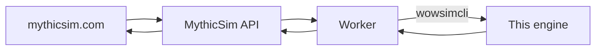

# WoW Forever Simulator (deprecated Go engine)

> [!WARNING]
> **Deprecated.** This Go engine is no longer maintained and takes no new patches, issues or pull requests. Use the Rust engine instead: **[sage3648/mythicsim-forever-engine](https://github.com/sage3648/mythicsim-forever-engine)**.
>
> Since 27 October 2026 every Forever sim on [MythicSim](https://mythicsim.com/wow-forever) runs in Rust, and since 21 October new Forever work (client updates, hotfixes, rotations, fixes) lands there only. This fork stays public as the reference the Rust engine was ported from and still reproduces at its pin.

The simulation engine MythicSim ran on until 27 October 2026, kept as an open fork of the WoW Forever sim. It models every class and spec for World of Warcraft: Forever, with the beta client data as the source of truth.

## How it fits together

Until 27 October 2026, MythicSim ran this engine as a separate `wowsimcli` process. It now runs the Rust engine in its place. You can still build and run this one yourself, see below.

## Running it locally

You need Go, protobuf and Node. The `makefile` has the build, test and UI targets.

## Contributing

This repo no longer takes contributions. Open fixes, mechanics changes and new data against the Rust engine, [sage3648/mythicsim-forever-engine](https://github.com/sage3648/mythicsim-forever-engine), and say where the numbers come from (client data, a log, a spell tooltip).

Background docs from the Go era:

- [Forever rule changes](docs/forever_rules.md)
- [Where upstream is heading](docs/upstream_alignment.md)
- [Fork notes and talent data pipeline](docs/fork-notes.md)

## Credits and license

MIT, same as upstream. This is a fork of [ElliotWood/Forever](https://github.com/ElliotWood/Forever), which builds on the official [wowsims/forever](https://github.com/wowsims/forever) and [wowsims/classic](https://github.com/wowsims/classic). Credit to the wowsims team and every contributor there. If you build on this, please keep a visible link back to the original projects.
